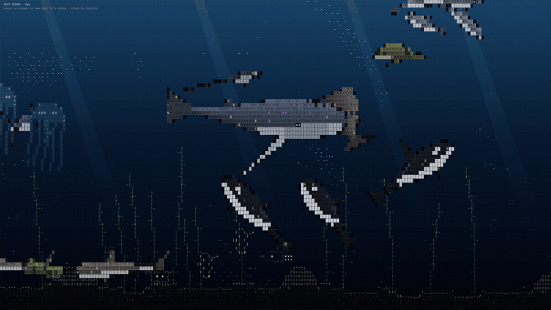

<div align="center">



### A living deep-sea aquarium, drawn entirely in ASCII.

**ascii-deepsea** is a side view into the deep ocean rendered as ASCII on a canvas — 20 kinds of marine life, each driven by a behaviour engine modelled on how the real animal hunts, feeds, hides, migrates and plays.

[](#-quick-start)
[](#-quick-start)
[](#-the-cast)
[](LICENSE)
[](https://github.com/inspiriflow/ascii-deepsea)

[Demo](#-demo) · [The cast](#-the-cast) · [How it works](#-how-it-works) · [Quick start](#-quick-start) · [Credits](#-credits)

</div>

---

## 🌊 What is ascii-deepsea

Most ASCII animations loop a canned sequence. ascii-deepsea is a small ecosystem instead: nothing is scripted. Every animal runs its own state machine and reacts to what is around it, so the scene never plays out the same way twice.

A humpback notices a school of sardines, dives beneath it and blows a ring of bubbles. The trapped fish pack into a ball, and the whale lunges up through the middle. The scraps sink to the seabed, where a crab scuttles over to eat them. Meanwhile an octopus spots the crab, and a passing shark makes the octopus ink and bolt.

## ✨ Why ascii-deepsea

- **Behaviour, not animation.** Each animal is a state machine built from real natural history: hunting strategies, escape responses, breathing, courtship.
- **Animals react to each other.** Sharks flee orcas, squid ink when a sperm whale closes in, fish drift toward an anglerfish's lure, dolphins ride a whale's bow wave.
- **A day/night cycle.** Sun shafts fade, bioluminescence brightens, and lanternfish, krill and swordfish make the daily vertical migration.
- **Interactive.** Hover any animal to see what it is doing right now. Click to startle the fish. Dolphins come over to play with your cursor.
- **Zero runtime dependencies.** One canvas, plain TypeScript, about 6 ms per frame at 1440×900.

## 🎬 Demo

> The GIF above is 20 seconds of the live scene. Run it locally to watch the full day/night cycle and hover the animals.

## 🐋 The cast

| Animal | What it does |
|---|---|
| 🐋 **Sperm whale** | Dives deep to hunt the giant squid using echolocation clicks that speed up into a "creak" as it closes in; surfaces to breathe; sleeps hanging upright |
| 🐳 **Humpback whale** | Cruises and sings; dives under a school, blows a spiral bubble net to trap it, then lunge-feeds up through the middle with its throat pleats ballooning |
| 🖤 **Orca** (pod of 3) | Travels in formation; carousel-feeds by circling a school into a tight ball, then takes turns tail-slapping into it |
| 🐬 **Bottlenose dolphin** (pod of 4) | Porpoises along; rides the bow wave of passing whales; comes over to play around your cursor; herds fish to hunt |
| 🦈 **Great white shark** | Patrols, stalks prey from below, then bursts upward in an ambush strike; clears out when orcas show up |
| 🔨 **Hammerhead shark** | Swims in a loose group, then sweeps the seabed with its wide head, sensing buried prey by electroreception; flees orcas |
| 🗡️ **Swordfish** | Rests deep by day and rises to feed at night; slashes through schools with its bill, then circles back for stunned fish |
| 🪽 **Manta ray** | Glides on slow wingbeats; over a krill swarm it somersaults, looping backwards again and again through the food |
| 🐢 **Sea turtle** | Paddles slowly; surfaces to breathe every minute or so; hunts and eats jellyfish |
| 🦑 **Giant squid** | Moves by jet pulses; creeps up on prey arms-first and fires its two long tentacles; inks and jets away from sperm whales |
| 🐙 **Octopus** | Crawls the seabed and forages; stalks crabs; camouflages when a predator is near; inks and jets away if it gets too close |
| 🪼 **Moon jellyfish** | Pulses its bell in rhythm, otherwise drifts with the current; glows, brightest at night |
| 🐍 **Moray eel** | Peeks from its rock den gaping to breathe; lunges at fish that stray within reach, then pulls back in |
| 🎣 **Anglerfish** | Hangs almost motionless with a glowing lure; small fish drift toward the light and get gulped |
| 🌿 **Seahorse** | Grips swaying kelp with its tail; swims slowly between stalks; pairs perform a synchronised courtship dance |
| 🦀 **Crab** | Scuttles sideways; picks at the sand; scavenges scraps that sink from feeding above; runs from the octopus |
| 🐟 **Sardine** | Schools into rotating bait balls; alarm spreads through the school like a wave when a predator appears |
| 🐟 **Anchovy** | Forms long polarised ribbons; splits around predators and rejoins behind them (the fountain effect) |
| ✨ **Lanternfish** | Glowing schools making the diel vertical migration: deep by day, near the surface at night |
| 🦐 **Krill** | Dense drifting swarms that rise at night; food for mantas and humpbacks |

## 🧭 How it works

```
World step (60 Hz, fixed timestep)
        │
        ▼
1. Animals think       → each runs its state machine and sets a desired velocity
2. Physics             → ease toward it, turn (foreshortening mid-turn), pitch, stay in bounds
3. Shared signals      → threats, herding points, lures, ink, bubbles, sinking food scraps
4. Fish                → boids schools react to all of the above
        │
        ▼
Renderer
5. Water + light       → depth gradient, sun shafts, marine snow, day/night
6. Bodies → cells      → side-view shape functions, supersampled into ASCII cells
7. Sprites             → small seabed animals as hand-drawn ASCII, mirrored when facing left
8. Effects             → wakes, sonar rings, whale song, ink clouds, glow
```

Each animal is a body plus a behaviour engine:

```ts
// The octopus, abridged
if (threat within 130px)  → "jetting away (ink!)"   // ink cloud, streamline, jet
if (threat within 300px)  → "camouflaged"           // fade into the seabed
if (crab within 220px)    → "stalking a crab"       // creep, pounce
otherwise                 → "crawling" / "foraging with its arms"
```

## 🚀 Quick start

**Chrome extension (no setup)**

There's a Chrome extension that puts the ocean on every new tab. Download it and play with it yourself:

1. Download [`ascii-deepsea-extension.zip`](https://github.com/inspiriflow/ascii-deepsea/releases/latest/download/ascii-deepsea-extension.zip) from [Releases](https://github.com/inspiriflow/ascii-deepsea/releases/latest) and unzip it.
2. Open `chrome://extensions` and turn on **Developer mode** (top right).
3. Click **Load unpacked** and choose the unzipped folder.
4. Open a new tab. If Chrome asks *"Change back to Google?"*, choose **Keep it**.

It runs fully offline (the font is bundled, nothing is fetched from the network) and works in any Chromium browser: Chrome, Edge, Brave, Arc.

**Run it locally**

```bash
git clone https://github.com/inspiriflow/ascii-deepsea.git
cd ascii-deepsea
npm install
npm run dev
```

Open the local URL Vite prints, hover an animal to see what it's doing, and click to startle the fish.

**Build the extension from source**

```bash
npm run build:extension      # → dist-extension/, then Load unpacked as above
```

## 🧩 Options

| Option | Example | Effect |
|---|---|---|
| `?only=` | `?only=orca,humpback` | Show only these animals (fish always swim) |
| `npm run check` | | Headless run: simulates 400 s, asserts nothing breaks, prints every behaviour each animal reached |

Use it in your own page:

```ts
import { OceanEngine } from "./src";

new OceanEngine(document.querySelector("canvas")!);            // the full cast
new OceanEngine(canvas, ["jelly", "angler", "octopus"]);         // a quieter tank
```

## 🏗️ Project structure

```
src/
├── creatures.ts   # The 16 animals: side-view bodies + behaviour state machines
├── world.ts       # Fish schools, seabed, kelp, day/night, shared signals
├── renderer.ts    # ASCII rendering: water, light, bodies, sprites, effects, HUD
├── species.ts     # Fish species: schooling weights, depth by day and night
├── engine.ts      # Canvas loop, resize, pointer input, reduced motion
└── math.ts        # Noise, ocean current field, helpers
extension/         # Chrome extension: manifest + new-tab page
check.ts           # Headless behaviour check
assets/            # Demo GIF
```

## 🙏 Credits

Built on [**ascii-sharks**](https://github.com/stackedlol/ascii-sharks) by stackedlol. The fish schooling (boids with alarm waves and the fountain effect), the ASCII cell renderer with supersampled edges, the wake field and the ocean current come from that project. ascii-deepsea extends it into a side-view deep-sea ecosystem with 16 new animals, behaviour engines, a seabed and a day/night cycle.

## 🤝 Contributing

Issues and pull requests are welcome, especially new animals, more realistic behaviours, and better ASCII bodies.

## ⚖️ License

[MIT](LICENSE) © Alex Lou. Original ascii-sharks code © drewdi, MIT.
